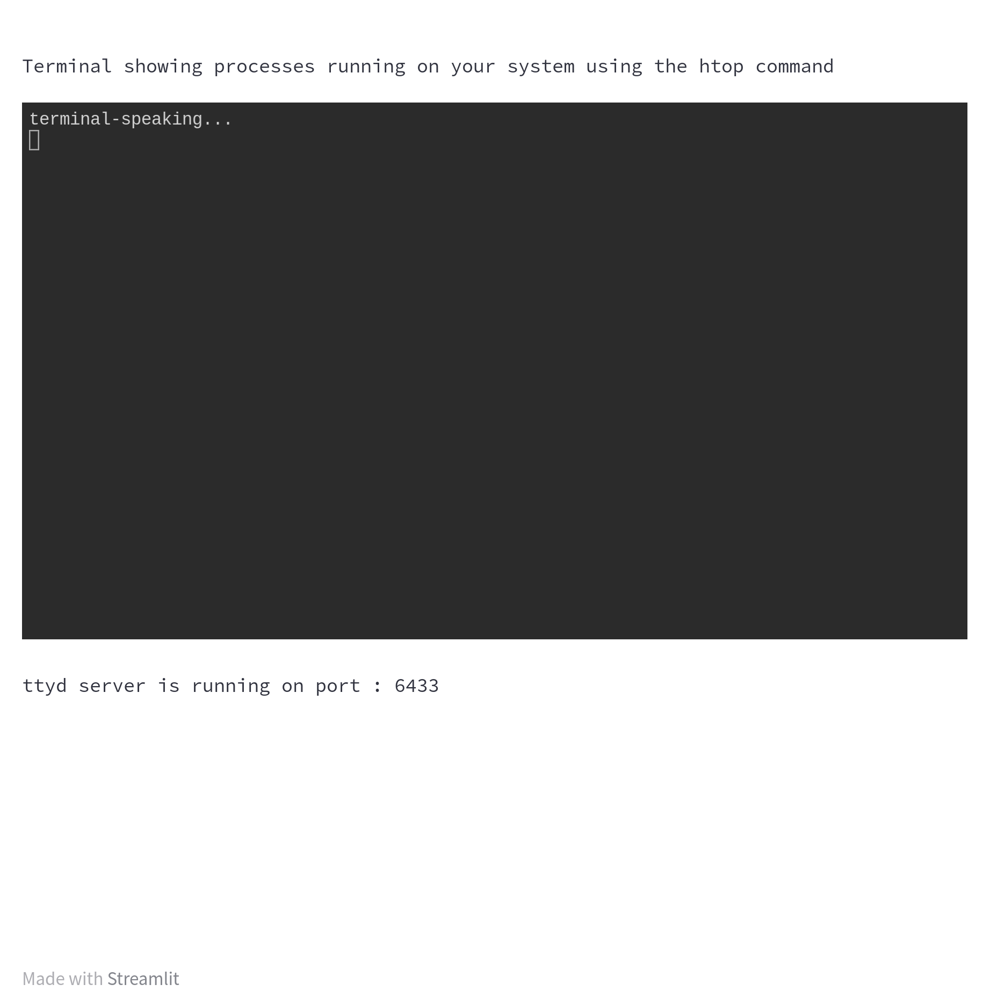

# streamlit-ttyd

A [Streamlit](https://streamlit.io/) plugin that embeds a fully interactive terminal in your app, powered by the excellent [ttyd](https://github.com/tsl0922/ttyd) project.

## Platform Support

| Platform | Architecture | Status |
|----------|-------------|--------|
| Linux    | x86_64, aarch64, arm | Supported |
| macOS    | x86_64, aarch64 | Supported |
| Windows  | — | Not yet supported |

> If you need Windows or other platform support, please [open an issue](https://github.com/NeveIsa/streamlit-ttyd/issues).

## Installation

```bash
pip install streamlit-ttyd
```

## Quick Start

```python
import streamlit as st
from streamlit_ttyd import terminal
import time

st.text("Terminal showing processes running on your system using the top command")

# Start the ttyd server and display the terminal on Streamlit
ttydprocess, port = terminal(cmd="top")

# Info on ttyd port
st.text(f"ttyd server is running on port: {port}")

# Kill the ttyd server after a minute
time.sleep(60)
ttydprocess.kill()
```

## API Reference

### `terminal(**kwargs) -> tuple[subprocess.Popen, int]`

Starts a ttyd server and embeds an interactive terminal iframe in the Streamlit app.

**Returns:** A tuple of `(ttyd_process, port)`.

**Parameters:**

| Parameter | Type | Default | Description |
|-----------|------|---------|-------------|
| `cmd` | `str` | `"echo terminal-speaking... && sleep 99999"` | The shell command to run in the terminal |
| `readonly` | `bool` | `False` | If `True`, the terminal is read-only (no user input) |
| `host` | `str` | `"http://localhost"` | Protocol and hostname where the Streamlit server is running |
| `port` | `int` | `0` | Port for the ttyd server. `0` auto-selects a free port in the 5000–7000 range |
| `exit_on_disconnect` | `bool` | `True` | Kill the ttyd server when the web terminal disconnects |
| `height` | `int` | `400` | Height of the terminal iframe in pixels |
| `ttyd` | `str` | `""` | Custom path to a ttyd binary. If empty, uses the bundled binary |

## Demo



## License

This project is licensed under the [MIT License](LICENSE).

ttyd is also MIT licensed — its license is included in the [ttyd_license](ttyd_license) file.
